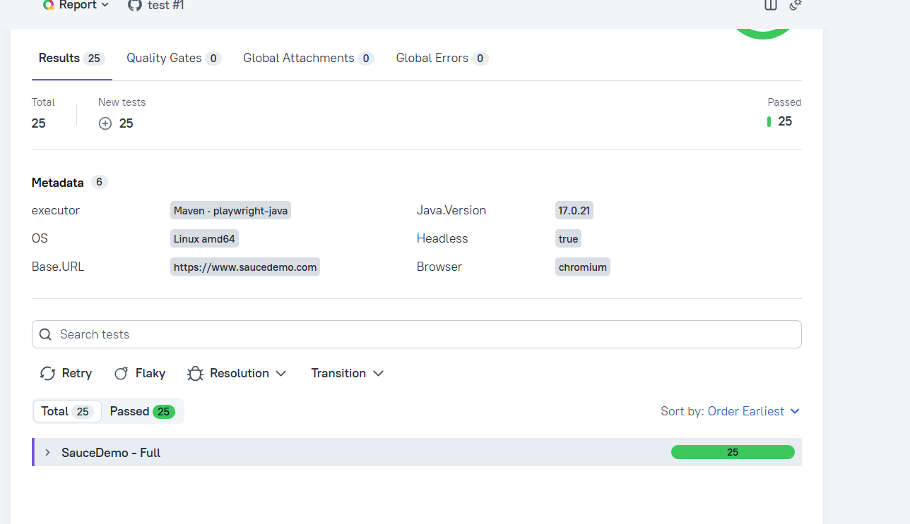

# Playwright Java UI Test Framework

[](https://github.com/Yerkkee/playwright_java/actions/workflows/ui-tests.yml)
[](https://yerkkee.github.io/playwright_java/)


UI test automation framework for [SauceDemo](https://www.saucedemo.com), built with Playwright for Java, TestNG and Allure.
It covers login, catalog, cart and checkout, runs in parallel, and attaches a screenshot, a Playwright trace
and a video to every failed test.

**Live report:** https://yerkkee.github.io/playwright_java/ (rebuilt by CI on every push to `main`)



## Tech stack

| Area | Tools |
|---|---|
| Language / build | Java 17, Maven (wrapper included) |
| Browser automation | Playwright for Java 1.64 (Chromium, Firefox, WebKit) |
| Test runner | TestNG 7.12 (groups, DataProviders, parallel methods) |
| Assertions | AssertJ for test checks, Playwright `assertThat` for auto-waiting UI checks |
| Reporting | Allure 3 (steps, categories, environment, trend history) |
| Logging | SLF4J (thread name in every line) |
| Boilerplate | Lombok |
| CI | GitHub Actions + GitHub Pages |

## Project structure

```
.
├── .github/workflows/ui-tests.yml        # CI: tests, artifacts, Allure report on GitHub Pages
├── allurerc.yml                          # Allure 3 config: report name, failure categories, history limit
├── pom.xml
├── mvnw, mvnw.cmd                        # Maven wrapper - no local Maven install needed
└── src
    ├── main/java/com/yerkkee
    │   ├── config/                       # TestConfig (typed config), BrowserName
    │   ├── data/                         # TestUser, Product, SortOption, CheckoutInfo, LoginCase, Messages
    │   ├── pages/                        # Page Objects: Login, Inventory, Cart, CheckoutStepOne/Two, CheckoutComplete
    │   │   └── components/               # HeaderComponent, BurgerMenuComponent
    │   └── utils/                        # Prices (money parsing)
    └── test
        ├── java/com/yerkkee
        │   ├── base/                     # BaseTest, PlaywrightManager (ThreadLocal lifecycle)
        │   ├── listeners/                # AllureArtifactsListener (screenshot / trace / video on failure)
        │   ├── tests/                    # LoginTest, InventoryTest, CartTest, CheckoutTest
        │   └── utils/                    # AllureEnvironmentWriter
        └── resources
            ├── META-INF/services/        # registers the listener for any run (suite, -Dtest, IDE)
            ├── config.properties         # default configuration
            ├── testng.xml                # full suite, parallel
            └── smoke.xml                 # smoke group only, parallel
```

## Running locally

Requirements: JDK 17+. Maven is not required - use the wrapper (`./mvnw` on Linux/macOS, `mvnw.cmd` on Windows).
Playwright downloads browsers automatically on the first run.

```bash
# Full suite: headless Chromium, 4 parallel threads
./mvnw clean test

# Smoke suite only
./mvnw clean test -Dsuite.file=smoke.xml

# Another browser
./mvnw clean test -Dbrowser=firefox

# Watch the browser while debugging: headed and slowed down
./mvnw clean test -Dheadless=false -Dslow.mo=500

# Single test class
./mvnw clean test -Dtest=CheckoutTest
```

### Configuration

Defaults live in [`src/test/resources/config.properties`](src/test/resources/config.properties).
Every key can be overridden, highest priority first:

1. JVM system property: `-Dbase.url=https://staging.example.com`
2. Environment variable: `BASE_URL=...` (dots become underscores, upper case)
3. `config.properties`

| Key | Default | Meaning |
|---|---|---|
| `base.url` | `https://www.saucedemo.com` | Application under test |
| `browser` | `chromium` | `chromium` / `firefox` / `webkit` |
| `headless` | `true` | Run without a visible window |
| `slow.mo` | `0` | Delay (ms) before each Playwright action |
| `viewport.width` / `viewport.height` | `1920` / `1080` | Browser viewport |
| `default.timeout` / `navigation.timeout` | `10000` / `30000` | Action and assertion timeout / navigation timeout (ms) |
| `screenshot.on.failure` / `trace.on.failure` / `video.on.failure` | `true` | Artifacts attached to failed tests |
| `user.password` | demo password | Shared password of SauceDemo users (env `USER_PASSWORD`) |

## Allure report

```bash
# Generate and open the report in a browser (after a test run)
./mvnw allure:serve

# Or only generate it into target/site/allure-maven-plugin
./mvnw allure:report
```

The plugin downloads Allure 3 and Node.js into `.allure/` on the first call (git-ignored).

What the report contains:

- **Steps**: every page-object method is an Allure step, so a failed test reads like a scenario.
- **Failure artifacts**: full-page screenshot, Playwright trace (open at [trace.playwright.dev](https://trace.playwright.dev)) and video, only for failed tests.
- **Categories**: *Product defects* (assertion failed), *Test defects* (locator timeout, wrong state), *Broken* (anything else).
- **Environment**: browser, headless mode, base URL, Java version, OS.
- **Trend**: CI keeps the history of the last 20 runs on the `gh-pages` branch.

## Test coverage

25 test runs from 15 test methods. `smoke` group: 5 critical-path tests; `regression` group: everything.

| Area | Scenarios |
|---|---|
| **Login** | successful login · locked-out user · invalid credentials (DataProvider, 4 cases: wrong password, unknown user, wrong-case username, trailing space) · empty required fields (DataProvider, 3 cases) · logout ends the session · Products page is not reachable without login |
| **Inventory** | catalog shows all 6 products with correct prices · sorting by Name A→Z / Z→A and Price low→high / high→low (DataProvider) |
| **Cart** | added product updates the badge and appears in the cart · remove on Products page · remove on Cart page · several products with prices |
| **Checkout** | end-to-end purchase to "Thank you for your order!" · required field validation (DataProvider, 3 fields) · Item total = sum of product prices, Total = Item total + Tax |

## Key design decisions

- **Page Object Model with fluent navigation.** Actions that change the page return the next page object
  (`loginAs()` → `InventoryPage`, `checkout()` → `CheckoutStepOnePage`), and each transition waits for the new page.
  Tests never touch Playwright's `Page` or `Locator`.
- **Locators only via `getByTestId` / `getByRole`.** SauceDemo exposes `data-test` attributes; the only element without one,
  the burger menu button, is found by its accessible name. Products are located by their exact visible name,
  not by generated ids.
- **Where an assertion lives.** Waiting checks of UI state that changes asynchronously (a badge appears, a page opens)
  live in the page object with Playwright's auto-retrying `assertThat`. Checks of business results (values, lists, totals)
  live in the test with AssertJ, on plain data returned by the page object.
- **Thread-safe parallel runs with `ThreadLocal`.** `PlaywrightManager` keeps Playwright, Browser, BrowserContext and Page
  per thread. Playwright Java is thread-affine (objects must be used and closed in the thread that created them),
  so each test creates and closes its own browser in `@BeforeMethod` / `@AfterMethod` on the same thread.
  The suite runs with `parallel="methods"`, 4 threads.
- **Artifacts only on failure.** Tracing and video are recorded for every test, then discarded for passed tests and attached
  to Allure for failed ones. Failures in `@BeforeMethod` are covered too (`IConfigurationListener`).
- **Independent tests.** Each test has its own browser context and data, so execution order does not matter.
  Tests that are not about login authenticate with the `session-username` cookie instead of the login form:
  faster and less flaky, while `LoginTest` covers the real form.
- **Robust checks.** Sorting compares the real list from the page with a copy sorted in Java (not a hardcoded list).
  Money uses `BigDecimal` to avoid floating-point errors in totals.
- **No secrets in reports.** The password comes from configuration, is masked in logs and never reaches `allure-results`:
  methods that receive it build Allure steps without recording arguments, and DataProvider rows print only a description.
- **No sleeps, no retries.** All waiting is done by Playwright's auto-waiting. There is no retry analyzer:
  retries hide flaky tests; stability is checked by running the full parallel suite several times in a row.

## CI

[`.github/workflows/ui-tests.yml`](.github/workflows/ui-tests.yml) runs on push, pull request and manually
(**Actions → UI Tests → Run workflow**, with a choice of browser and suite):

1. Sets up Java 17 with Maven cache, installs the Playwright browser with OS dependencies.
2. Runs the tests headless.
3. Uploads `allure-results`, and traces + videos of failed tests, as build artifacts.
4. Builds the Allure report with history and publishes it to GitHub Pages (from `main` only;
   for other branches and pull requests the report is available as an artifact).

## Known limitations

- A Playwright trace records the values typed into fields, so the trace of a failed login test contains the password.
  This is acceptable for SauceDemo's public demo password; for a real application, disable traces for login steps
  or use test-only accounts.

## Roadmap

- [ ] Cross-browser matrix in CI (Chromium, Firefox, WebKit in parallel jobs)
- [ ] Tests for SauceDemo's intentionally buggy users (`problem_user`, `error_user`) to show *Product defects* in the report
- [ ] Visual regression checks with screenshot comparison
- [ ] Accessibility checks (axe-core)
- [ ] Code style and static analysis in CI (Checkstyle / SpotBugs)
